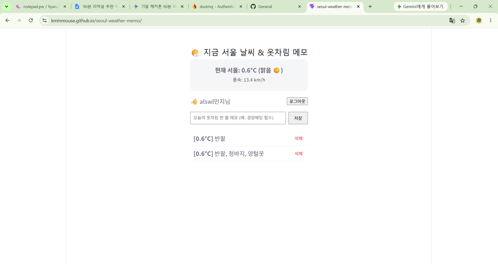

# 지금 서울 날씨 & 나의 옷차림 메모
- **배포 URL**: https://kminmouse.github.io/seoul-weather-memo/
- **사용 기술**: React, Vite, Firebase (Authentication, Cloud Firestore), GitHub Pages
- **사용 API**: Open-Meteo Forecast API (서울 기온·날씨·풍속 조회)
- **주요 기능**:
  1. 서울 실시간 기온 및 날씨 상태 조회
  2. Google 계정 기반 Firebase 로그인/로그아웃
  3. 사용자별 옷차림 한 줄 메모 Firestore 저장, 실시간 조회 및 삭제
  ### 실행 화면

